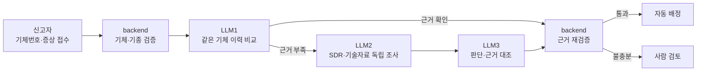
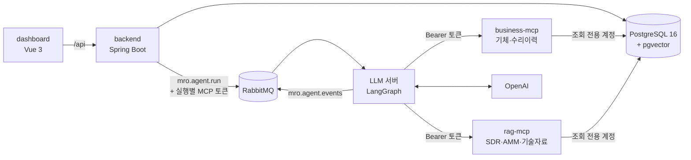
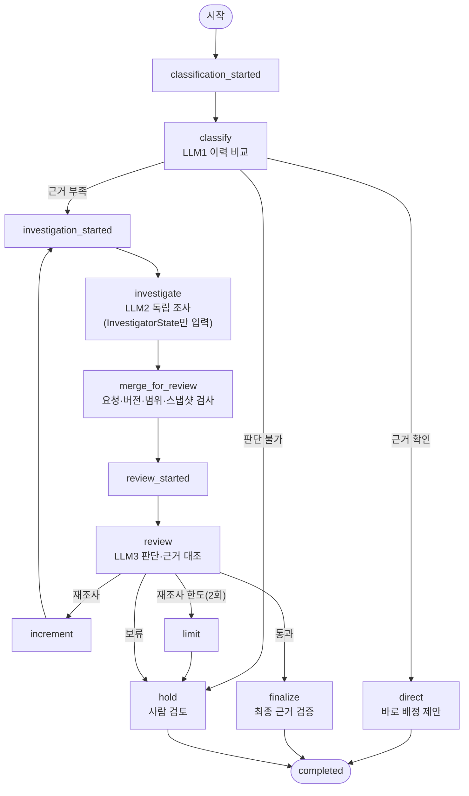
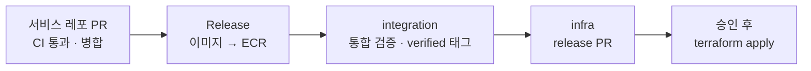

# MRO Agent

### 항공기 정비요청 AI Agent

정비 신고를 읽고, 근거를 찾고, 맞는 정비팀에 배정합니다

**"근거 없이는 배정하지 않는다."**

현장에서 올라온 정비 신고, 어느 정비팀에 보내야 할까요? 
MRO Agent는 같은 기체의 수리이력과 **FAA 정비 결함 사례 71,741건**을 근거로 담당 부서를 추천하고, 
근거가 검증될 때만 자동으로 배정합니다. 확신이 없으면 사람에게 넘깁니다.

 

 

## 30초 요약

> **문제** — 정비 신고가 들어오면 사람이 증상을 읽고, 비슷한 과거 사례를 찾고, 담당 정비팀을 정해야 합니다. 신고가 많을수록 **분류와 근거 찾기**에 시간이 걸리고, 담당자마다 판단이 달라집니다.
>
> **해결** — AI Agent가 신고를 받아 **같은 기체의 수리이력**을 먼저 비교하고, 부족하면 **SDR(정비 결함 보고) 사례와 기술자료**를 직접 검색해 담당 부서를 추천합니다.
>
> **결과** — 인용한 근거가 실제로 조회된 자료인지 백엔드가 다시 검증합니다. 통과하면 **자동 배정**, 아니면 **사람 검토**로 넘어갑니다.

 

## 왜 만들었나요?

정비가 처음이라면 이렇게 생각해 보세요.

> **응급실 접수**를 떠올려 보세요. 
> 환자가 "가슴이 답답해요"라고 말하면, 접수 간호사는 증상과 과거 진료 기록을 보고 어느 과로 보낼지 정합니다. 
> 잘못 보내면 다른 과로 다시 옮겨야 하고, 그만큼 치료가 늦어집니다.

항공기 정비도 같습니다. "엔진 시동 시 진동 발생" 같은 신고 한 줄을 보고 **어느 계통(ATA)의 문제인지, 어느 정비팀이 맡아야 하는지**를 정해야 합니다.

<table>
<tr>
<td align="center" width="33%"><h2>71,741건</h2>검색에 쓰는 FAA 정비 결함 보고(SDR)</td>
<td align="center" width="33%"><h2>1,600건</h2>기체 20대의 수리이력</td>
<td align="center" width="33%"><h2>8개</h2>배정 대상 정비 부서</td>
</tr>
</table>

- **같은 증상이라도 기체 이력에 따라 원인이 다릅니다.** 그래서 먼저 같은 기체의 과거 수리를 봅니다.
- **AI의 답은 틀릴 수 있습니다.** 그래서 AI가 인용한 근거를 코드로 다시 확인하고, 확인되지 않으면 배정하지 않습니다.
- **판단 과정이 남아야 합니다.** 정비팀은 AI가 왜 그렇게 판단했는지, 어떤 사례를 봤는지 화면에서 바로 봅니다.

 

## 어떻게 동작하나요?

1. **신고 접수** — 신고자가 기체번호·기종·증상을 입력합니다. 등록 정보와 다르면 백엔드가 맞는 값을 알려 줍니다.
2. **이력 비교 (LLM1)** — 증상만 보고 계통(ATA) 후보를 고른 뒤, 같은 기체의 해당 계통 수리이력과 비교합니다. 근거가 확실하면 바로 배정을 제안합니다.
3. **독립 조사 (LLM2)** — 이력으로 판단할 수 없으면, LLM1의 결론을 **보지 않은 채** SDR 사례와 Airbus 기술자료를 직접 검색해 판단합니다.
4. **검토 (LLM3)** — 두 판단과 원문을 대조합니다. 풀리지 않은 충돌이 있으면 다시 조사시킵니다(최대 2회).
5. **근거 재검증** — 백엔드가 인용 근거가 실제로 조회된 자료인지, 부서 코드가 맞는지 확인한 뒤 배정하거나 사람 검토로 보냅니다.
6. **정비팀 확인** — 배정된 정비팀이 수락하거나 거절하고, 관리자가 사람 검토 건을 처리합니다.

### 요청 상태

| 상태 | 언제? | 화면에서 |
|:--:|:--|:--|
| **QUEUED** | 접수 직후 | 처리 대기 |
| **CLASSIFYING → INVESTIGATING → REVIEWING** | AI가 단계별로 판단 중 | 3초마다 진행 단계 갱신 |
| **ASSIGNED** | 근거 검증 통과 | 담당 정비팀 대기 목록에 표시 |
| **HUMAN_REVIEW** | 근거 부족·판단 충돌·시간 초과 | 관리자 검토 목록에 표시 |
| **ACCEPTED** | 정비팀이 배정 수락 | 처리 이력에 기록 |

 

## 사용자가 마주하는 화면

### ① 신고자: 접수와 진행 상황
기체번호와 증상을 적어 접수하고, 내 요청이 어느 단계에 있는지 실시간으로 봅니다.

<table>
<tr>
<td width="50%"></td>
<td width="50%"></td>
</tr>
</table>

### ② 정비팀: 배정 확인과 근거
우리 부서에 배정된 요청을 보고, AI 판단 요약·인용 근거·처리 이력을 확인한 뒤 수락하거나 거절합니다.

<table>
<tr>
<td width="50%"></td>
<td width="50%"></td>
</tr>
</table>

### ③ 관리자: 사람 검토와 운영 현황
사람 검토로 넘어온 요청을 수동 배정·종결하고, 자동 배정률과 RAG 데이터 상태, 부서별 인원 현황을 봅니다.

<table>
<tr>
<td width="50%"></td>
<td width="50%"></td>
</tr>
</table>

 

## 얼마나 맞히나요?

실제 경로(backend → RabbitMQ → AI(gpt-5.4-mini) → MCP → PostgreSQL)로 **서비스 시나리오 200건**을 실행했습니다. (2026-10-23)

| 지표 | 결과 | 의미 |
|:--|:--:|:--|
| 자동배정 정밀도 | **96/145 (66.2%)** | AI가 자동 배정한 건 중 정답 부서 |
| LLM2 독립 조사 부서 일치 | **71/82 (86.6%)** | 이력 없이 사례 검색만으로 맞힌 비율 |
| 전체 평가 통과 | **97/200 (48.5%)** | 기대 상태·허용 부서·금지 이력 조건을 모두 만족 |
| 정답 부서를 맞히고도 보류 | **42건** | 확신이 부족해 사람 검토로 넘긴 경우 (성공에 합산하지 않음) |
| 시스템 오류 · 시간 초과 | **0건** | 200건 + 접수 검증 6건 전체 |

> 통과 기준을 엄격하게 잡았습니다. 정답 부서를 맞혀도 금지된 이력을 근거로 썼거나 사람 검토가 필요한 사례를 자동 배정하면 실패로 셉니다. 실제 항공사 운영 성능으로 일반화하지 않습니다.

 

## 시스템 구조

> 여기부터는 개발자를 위한 내용입니다.

AWS 배포 구성은 Terraform으로 정의했습니다. 배포는 [infra](https://github.com/mro-agent-proj/infra) 레포에서만 합니다.

<b> 데이터 구성</b>

 

| 데이터 | 규모 | 용도 |
|:--|:--|:--|
| SDR 사례 | 71,741건 | FAA 정비 결함 보고. LLM2의 사례 검색 (단어 + 임베딩 하이브리드) |
| SDR 임베딩 | 71,741건 | OpenAI text-embedding-3-large, 1024차원 |
| AMM 참조 | 35,396건 | 정비 매뉴얼 번호 (배정 후 참고 정보로만 첨부, 판단 근거로는 쓰지 않음) |
| JASC 코드 | 548개 | 결함 분류 코드 ↔ ATA 계통 매핑 |
| 기술자료 | Airbus Safety First 61편 | 기술자료 검색 (조각 496개) |
| 업무 시드 | 항공사 3 · 기체 20 · 부서 8 · 계정 15 · 수리이력 1,600 | 시연·평가용 |
| 평가셋 | 서비스 시나리오 200건 | dev 80 / test 120 |

 

## LangGraph: AI 판단 흐름

AI 서버는 LangGraph로 판단 단계를 그래프로 연결합니다. 단계마다 상태(State)를 체크포인트에 저장해, 서버가 재시작돼도 멈춘 단계부터 이어 갑니다.

| 노드 | 하는 일 |
|:--|:--|
| `classify` | 증상만 보고 ATA 후보를 고른 뒤, 같은 기체의 수리이력과 비교 (LLM1) |
| `investigate` | LLM1 결론·수리이력을 받지 않고, 원본 신고와 자체 검색 결과만으로 조사 (LLM2) |
| `merge_for_review` | LLM1·LLM2 결과를 합치기 전에 요청·버전·검색 범위·스냅샷이 그대로인지 검사 |
| `review` | 두 판단과 원문을 대조해 통과·재조사·보류를 결정 (LLM3) |
| `finalize` | 인용 근거를 다시 조회해 확인하고, 근거 SDR의 참고 AMM 번호를 첨부 |
| `hold` | 근거가 부족하거나 재조사 한도를 넘으면 사람 검토로 보냄 |

 

## MCP 도구

AI는 MCP(Model Context Protocol)로 두 서버의 도구 9개를 호출합니다. 두 서버 모두 **읽기 전용**이며, 요청마다 백엔드가 발급한 토큰과 검색 범위 안에서만 조회합니다.

| 서버 | ID | 도구 | 하는 일 | 누가 부르나 |
|:--|:--:|:--|:--|:--|
| business-mcp | B01 | `get_request_context` | 접수 내용과 이 실행에 등록된 검색 범위 | 실행기 (시작·최종 확정) |
| | B02 | `get_aircraft_history` | 같은 기체의 이전 수리이력 (접수 시각 이전만) | LLM1, LLM3, 최종 검증 (LLM2는 차단) |
| | B03 | `search_departments` | 정비 부서 8개와 담당 ATA | 실행기 (단계마다 고정 확인) |
| rag-mcp | R01 | `search_jasc_codes` | JASC 결함 코드 후보와 정의 | LLM2, LLM3 |
| | R02 | `search_sdr_cases` | SDR 사례 71,741건 하이브리드 검색 (단어 + 벡터, 한국어 질의 가능) | LLM2, LLM3 |
| | R03 | `search_amm_references` | AMM 번호로 그 번호가 인용된 SDR 문장 조회 | LLM 도구 목록에서 제외 |
| | R04 | `search_technical_docs` | Airbus Safety First 기술자료 의미 검색 | LLM2, LLM3 |
| | R05 | `get_evidence` | 받은 근거의 원문과 인용 위치 재확인 | LLM2, LLM3, 최종 검증 |
| | 확장 | `get_sdr_amm_references` | 근거 SDR에 인용된 AMM 번호 조회 (참고용 첨부) | 실행기 (배정 확정 후) |

> 서비스 시나리오 200건 실행에서 LLM2는 R01을 77회, R02를 84회 골라 썼고, 최종 검증은 R05를 97회 호출했습니다.

 

## 기술적으로 신경 쓴 점

<table>
<tr>
<td width="50%" valign="top">

### AI 판단의 신뢰성
- **판단 분리** — LLM2는 LLM1의 결론·수리이력을 전달받지 않고 원본 신고와 자체 검색 결과만으로 독립 판단합니다. 같은 결론을 베끼는 확증 편향을 막습니다.
- **근거는 코드가 검증** — 인용한 근거가 실제로 조회됐는지, 발췌가 원문에 있는지, 부서 코드가 유효한지 AI 서버와 백엔드가 두 번 확인합니다.
- **출력 검증** — 모든 LLM 출력을 pydantic으로 검증하고, 실패하면 오류를 알려 주고 한 번 더 받습니다.
- **AMM은 근거에서 제외** — 정비 매뉴얼 번호는 배정이 끝난 뒤 참고 정보로만 붙입니다.

</td>
<td width="50%" valign="top">

### 보안 · 운영
- **읽기 전용 MCP** — MCP 서버는 SELECT 전용 DB 계정으로만 접속하고, 쓰기 권한이 있으면 기동을 거부합니다.
- **실행별 위임 토큰** — 백엔드가 요청마다 검색 범위를 등록하고 수명이 짧은 MCP 토큰 2개를 발급합니다.
- **복구 가능한 실행** — RabbitMQ DLQ, 5분 처리 한도(넘으면 사람 검토), 단계별 체크포인트로 재시작해도 이어서 처리합니다.
- **검증된 조합만 배포** — 서비스 main이 바뀌면 봇이 통합 검증을 돌리고, 통과한 조합만 infra에서 승인 후 배포합니다.

</td>
</tr>
</table>

### 변경에서 배포까지

- 코드는 **서비스 레포에서만** 바꿉니다. integration은 봇이 자동으로 갱신하고, 운영 배포는 **infra에서만** 합니다.
- GitHub Actions는 **OIDC**로 AWS에 접근합니다. 장기 액세스 키를 쓰지 않습니다.
- CloudFront 앞의 **WAF**가 관리형 규칙, SQL 인젝션 차단, 로그인 요청 횟수 제한을 맡습니다.

 

## 리포지토리 구성

| 리포지토리 | 한 줄 설명 | 주요 기술 |
|:--|:--|:--|
| [**dashboard**](https://github.com/mro-agent-proj/dashboard) | 신고자·정비팀·관리자 화면 | Vue 3 · TypeScript · PrimeVue 4 |
| [**backend**](https://github.com/mro-agent-proj/backend) | 계정·요청·배정 API, DB·데이터 적재, MCP 토큰 발급 | Java 21 · Spring Boot · Flyway |
| [**LLM**](https://github.com/mro-agent-proj/LLM) | LLM1 분류 → LLM2 조사 → LLM3 검토 AI 서버 | Python · FastAPI · LangGraph · LangChain |
| [**agent**](https://github.com/mro-agent-proj/agent) | 업무 조회·근거 검색 MCP 서버 2개 (도구 9개) | Python · MCP · pgvector |
| [**integration**](https://github.com/mro-agent-proj/integration) | 서비스 4개의 검증된 커밋 조합, 실행·평가 스크립트 | Docker Compose · GitHub Actions |
| [**infra**](https://github.com/mro-agent-proj/infra) | AWS 인프라와 운영 배포 | Terraform · ECS Fargate · WAF |
| [**deliverables**](https://github.com/mro-agent-proj/deliverables) | 최종 결과보고서, 아키텍처 다이어그램 | |

 

## 기술 스택

**Backend** 

**AI & RAG** 

**Frontend** 

**Infra & DevOps** 

 

## 팀

<table>
<tr>
<td align="center" width="16%"><a href="https://github.com/younghoyk"> @younghoyk</a></td>
<td align="center" width="16%"><a href="https://github.com/Iod-oxy"> @Iod-oxy</a></td>
<td align="center" width="16%"><a href="https://github.com/kkwakna"> @kkwakna</a></td>
<td align="center" width="16%"><a href="https://github.com/ybkeem"> @ybkeem</a></td>
<td align="center" width="16%"><a href="https://github.com/goldmirr"> @goldmirr</a></td>
<td align="center" width="16%"><a href="https://github.com/Weeny326"> @Weeny326</a></td>
</tr>
</table>

 

## 용어 사전

항공 정비가 처음이라면 펼쳐 보세요

 

| 용어 | 쉬운 설명 |
|:--|:--|
| **MRO** | Maintenance, Repair & Overhaul. 항공기 정비·수리·분해점검 |
| **정비 신고** | 조종사·정비사가 발견한 결함을 알리는 요청서 |
| **ATA 챕터** | 항공기 계통 분류 번호. 예: 21 공조, 32 착륙장치, 72 엔진 |
| **SDR** | Service Difficulty Report. FAA에 보고된 정비 결함 사례 |
| **JASC 코드** | SDR에서 쓰는 결함 분류 코드. ATA 계통과 대응됩니다 |
| **AMM** | Aircraft Maintenance Manual. 기종별 정비 매뉴얼 |
| **RAG** | AI가 답하기 전에 관련 자료를 먼저 검색해 참고하는 방식 |
| **MCP** | Model Context Protocol. AI가 외부 도구·데이터를 호출하는 표준 규약 |
| **LangGraph** | AI 판단 단계를 그래프로 연결해 흐름을 제어하는 프레임워크 |
| **사람 검토** | AI가 확신하지 못한 요청을 관리자가 직접 판단하는 단계 |

 

**AI가 찾고, 근거가 증명하고, 사람이 결정합니다.**

© 2026 MRO Agent

